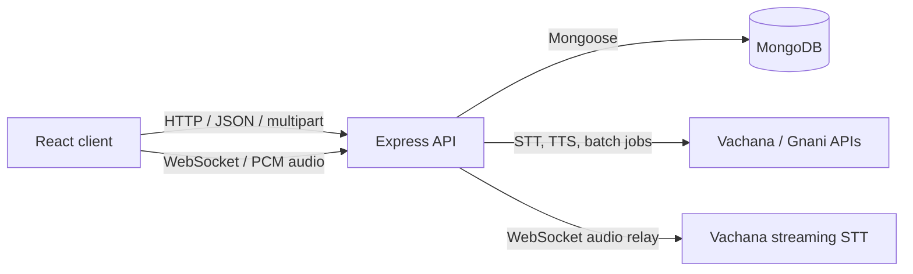

# VoiceBridge AI

VoiceBridge AI is a web application for speech transcription, speech generation, and audio translation. A React client sends requests to a Node.js/Express API. The API persists account, job, and provider-call metadata in MongoDB and forwards speech work to the Vachana/Gnani APIs. Live transcription uses a WebSocket bridge from the browser through the API to the speech provider.

The project was initially planned in Python. The implementation uses Node.js because its asynchronous I/O model fits the main workload: requests spend much of their time waiting on MongoDB and external speech services, while real-time sessions keep WebSocket connections open. Express, `fetch`, Mongoose, and `ws` let the backend handle that I/O without dedicating a thread to each wait. This is a workload fit, not a claim that Node.js is universally faster than Python.

## Product capabilities

- Register and sign in with a username, email, and password.
- Transcribe an audio upload synchronously or submit a batch job and poll its status.
- Generate speech from text, either as a WAV response or as a server-sent event stream.
- Transcribe an uploaded recording and synthesize the result in a selected language and voice.
- Transcribe microphone audio in real time over WebSockets.
- View supported voice catalogs without signing in.
- Persist users, processing-job state, and speech-provider request metadata in MongoDB.

## Architecture



The HTTP server and WebSocket server share the same Node process and listener. Startup loads environment variables, creates the HTTP server, attaches the WebSocket upgrade handler, waits for MongoDB to connect, and then begins listening on `PORT`. If the database connection fails, startup exits rather than accepting requests without persistence.

### Request lifecycles

**Authenticated HTTP request**

1. The client sends the JWT as a bearer token and also includes credentials for the HTTP-only cookie.
2. `requireAuth` verifies the token and attaches the user ID to the request.
3. Speech routes pass through the credit-eligibility middleware.
4. A route creates or updates a processing job, calls the external provider, records provider status/latency, and returns JSON or audio bytes.

**Full-cycle translation**

1. The API receives one audio file with `target_language` and `target_voice` form fields.
2. It submits the audio to STT with `prisma-v3.0` and `indic-auto`.
3. It sends the transcript to TTS using the selected voice and language.
4. It returns the synthesized audio and a base64-encoded transcript in the `X-Transcribed-Text` response header.

**Live transcription**

1. The browser captures microphone audio, downsamples it to 16 kHz, and encodes signed 16-bit PCM.
2. The browser opens `/speech/realtime` with model and stream settings. Because the browser WebSocket API cannot set an arbitrary `Authorization` header, the client sends its JWT in the `token` query parameter; the server can also read the auth cookie.
3. The API verifies the JWT and provider configuration, opens an authenticated upstream WebSocket, and relays binary audio frames and provider messages.
4. Closing the browser socket closes the upstream socket.

## Technology

| Component | Implementation |
| --- | --- |
| Web client | React 18, Vite, Tailwind CSS, lucide-react |
| HTTP API | Node.js, Express 5 |
| Realtime transport | Node HTTP server and `ws` |
| Persistence | MongoDB and Mongoose |
| Password hashing | bcryptjs |
| Session token | jsonwebtoken, HTTP-only cookie, bearer token |
| Speech provider | Vachana/Gnani STT and TTS endpoints |

## Repository layout

```text
VoiceBridge_AI/
├── client/
│   ├── src/App.jsx                 # Auth, translation, and live-transcription UI
│   ├── src/main.jsx                # React entry point
│   ├── src/style.css               # Application styles
│   └── vite.config.js              # Dev proxy for HTTP and WebSocket routes
├── server/
│   ├── server.js                   # Process startup and shared HTTP listener
│   └── src/
│       ├── app.js                  # Express middleware and route mounting
│       ├── db/db.js                # MongoDB connection
│       ├── middleware/
│       │   ├── requireAuth.js      # JWT verification
│       │   └── checkCredits.js     # Credit eligibility check
│       ├── models/                 # User, job, API-log, and media schemas
│       ├── realtime/               # Browser-to-provider WebSocket bridge
│       └── routes/                 # Authentication and speech endpoints
└── .env.example
```

## Data model

| Collection/model | Role |
| --- | --- |
| `users` | Unique username and email, password hash, credit limit, and credits used |
| `Job` | Per-user STT, TTS, or full-cycle job status, text, language, voice, error, and provider job ID |
| `apiLogs` | Provider, endpoint, HTTP status, latency, and billed-credit metadata associated with a job and user |
| `mediaAssets` | Schema for uploaded/generated media references; current request handlers use in-memory uploads and do not persist these records |

Passwords are hashed with bcryptjs and are excluded from ordinary user queries by default. New users receive a default credit total of 5,000. JWTs contain a user ID and expire after one hour.

## Requirements

- Node.js 20 or newer and npm. The server uses Node's built-in `fetch`, `FormData`, and `Blob` APIs.
- A MongoDB database, either local or hosted.
- A Vachana/Gnani API key ID for STT and TTS operations.

## Local development

### Configure and start the API

From the repository root, create the server environment file:

```sh
cp .env.example server/.env
```

In PowerShell, use:

```powershell
Copy-Item .env.example server/.env
```

Edit `server/.env` and set the required values:

| Variable | Required | Description |
| --- | --- | --- |
| `PORT` | No | HTTP and WebSocket port; defaults to `3000` |
| `NODE_ENV` | No | Set to `development` locally; production changes cookie security attributes |
| `MONGO_URI` | Yes | MongoDB connection string |
| `JWT_SECRET` | Yes | Private secret used to sign and verify JWTs |
| `GNANI_API_KEY_ID` | For speech features | Provider API key ID; keep this on the server |
| `FRONTEND_ORIGIN` | No | Present in the example file, but not currently consumed by the CORS middleware |

Install dependencies and run the server:

```sh
cd server
npm ci
npm run dev
```

The health check is `GET http://localhost:3000/`. The development command uses Node's watch mode; `npm start` runs the server without watch mode.

### Start the client

In a second terminal:

```sh
cd client
npm ci
npm run dev
```

Open the Vite URL printed in the terminal, normally `http://localhost:5173`. In development, Vite proxies `/auth` and `/speech` requests to `http://localhost:3000`, including WebSocket upgrades. Override the proxy target with `VITE_PROXY_TARGET` when the API runs elsewhere.

### Build the client

```sh
cd client
npm run build
```

The static production bundle is written to `client/dist`. The Express server does not serve this directory.

## Configuration and deployment

The frontend reads two optional build-time settings:

```env
VITE_API_BASE_URL=https://api.example.com
VITE_WS_BASE_URL=wss://api.example.com
```

Leave them unset for a same-origin deployment where a reverse proxy routes API and WebSocket traffic to the backend. For separate origins, set both to the deployed API origin. Never expose `MONGO_URI`, `JWT_SECRET`, or `GNANI_API_KEY_ID` through a `VITE_*` variable; frontend variables are compiled into browser-delivered assets.

### Render backend

For a Render Web Service configured from this repository:

- Root directory: `server`
- Build command: `npm install` (or `npm ci` when the lockfile is used)
- Start command: `npm start`
- Set `MONGO_URI`, `JWT_SECRET`, `GNANI_API_KEY_ID`, and `NODE_ENV=production` in the service environment.
- Keep WebSocket upgrades enabled for `/speech/realtime`.

### Static frontend

Deploy `client` as a static site with build command `npm run build` and publish directory `dist`. Configure the API and WebSocket base URLs for the backend host. If the frontend and API are on different origins, authentication depends on credentialed cross-origin requests and secure cookies; both sites must use HTTPS.

## HTTP API

All routes are relative to the API origin. JSON request examples omit the `Authorization` header for brevity; protected routes accept the JWT bearer token returned by login/registration or the auth cookie.

### Authentication

| Method | Route | Auth | Request | Success |
| --- | --- | --- | --- | --- |
| `POST` | `/auth/register` | No | JSON: `username`, `email`, `password` (minimum 8 characters) | `201` with `{ token, user }` |
| `POST` | `/auth/login` | No | JSON: `email`, `password` | `200` with `{ token, user }` |
| `GET` | `/auth/me` | Yes | — | `200` with `{ user }` |
| `POST` | `/auth/logout` | No | — | `200`; clears the token cookie |

Registration normalizes email case and trims username/email. Login and registration set an HTTP-only `token` cookie. In production that cookie is marked `Secure` and `SameSite=None`; in development it uses `SameSite=Lax`. The client also stores the returned JWT to send a bearer token with API calls.

An unauthenticated `GET /auth/me` returns `401`; that response means there is no valid session, not that the API is down.

### Speech

| Method | Route | Auth | Input | Success response |
| --- | --- | --- | --- | --- |
| `GET` | `/speech/voices?model=timbre-v3.0` | No | Optional model query (`timbre-v3.0` or `timbre-v2.5`) | Voice catalog JSON |
| `POST` | `/speech/stt` | Yes | Multipart: `audio`; optional `model`, `language_code` | Provider transcription JSON |
| `POST` | `/speech/stt/batch` | Yes | Multipart: `audio`; optional `model`, `language_code` | `202` with local `jobId` |
| `GET` | `/speech/stt/batch/:id` | Yes | Local job ID | Current status; transcript when complete |
| `POST` | `/speech/tts` | Yes | JSON: `text`, `voice`, optional `model`, `language` | Audio bytes; content type from provider or `audio/wav` |
| `POST` | `/speech/tts/stream` | Yes | JSON: `text`, `voice`, optional `model`, `language` | `text/event-stream` response |
| `POST` | `/speech/translate_voice` | Yes | Multipart: `audio`, `target_voice`, optional `target_language`, `tts_model` | Audio bytes and `X-Transcribed-Text` header |
| WebSocket | `/speech/realtime` | Yes | Query options described below; binary PCM messages | Provider transcript messages relayed to client |

STT models are `prisma-v2.5` and `prisma-v3.0`. TTS models are `timbre-v2.5` and `timbre-v3.0`. The voice catalog currently advertises Indian language codes including Hindi, English (India), Tamil, Telugu, Kannada, Malayalam, Marathi, Punjabi, Bengali, and Gujarati.

Standard upload transcription and full-cycle translation accept WAV, MP3, OGG, FLAC, AAC, and M4A extensions. Multer stores upload bytes in memory and applies a 10 MiB per-file limit. The server does not currently persist audio to the `mediaAssets` collection or object storage.

### Batch transcription lifecycle

`POST /speech/stt/batch` creates a provider job and returns `202 Accepted` with the application's `jobId`. Poll `GET /speech/stt/batch/:id` using that ID. The local record is scoped to the authenticated user. While the provider job is pending, the response contains its status; when completed, it includes the transcript. Provider failures set the local job status to `failed`.

### Example requests

Register and capture the returned token:

```sh
curl -i http://localhost:3000/auth/register \
  -H 'Content-Type: application/json' \
  -d '{"username":"Example User","email":"user@example.com","password":"replace-with-a-password"}'
```

Submit a transcription with a bearer token:

```sh
curl -i http://localhost:3000/speech/stt \
  -H 'Authorization: Bearer <jwt>' \
  -F 'audio=@./sample.wav' \
  -F 'model=prisma-v3.0' \
  -F 'language_code=indic-auto'
```

The browser client sends the JWT automatically after login. These commands are intended for local development; do not put real credentials or tokens into a checked-in script.

### HTTP status and error behavior

- `400`: malformed or incomplete input, unsupported model, or missing upload.
- `401`: missing, expired, or invalid authentication for a protected route; login also returns `401` for incorrect credentials.
- `403`: account has insufficient available credits. The credit middleware returns the current `used` and `limit` values.
- Provider failures are generally forwarded with the provider's status and a JSON error/details payload. TTS stream failures are emitted as an SSE `error` event after the stream headers have been sent.
- `500`: missing provider configuration or an internal/provider transport failure.

An anonymous request to the public health and voice-catalog routes should not be confused with a `401` from `/auth/me`, which is expected when no session is present.

## Realtime WebSocket protocol

Connect to `ws://` locally or `wss://` in production:

```text
/speech/realtime?model=prisma-v2.5&language_code=hi-IN&sample_rate=16000&format=verbatim&token=<jwt>
```

Supported settings enforced by the server:

| Parameter | Values / rule |
| --- | --- |
| `model` | `prisma-v2.5` or `prisma-v3.0` |
| `language_code` | Supported `*-IN` codes; up to one for v2.5 and four for v3.0, or `indic-auto` with v3.0 |
| `sample_rate` | `8000`, `16000`, `44100`, or `48000` Hz |
| `format` | v2.5: `verbatim`, `transcribe`; v3.0 also supports `codemix`, `transliterate` |
| `token` | Signed JWT; cookie authentication is also accepted |

The browser implementation sends binary signed 16-bit PCM frames of exactly 1,024 bytes (512 samples) and currently captures/resamples at 16 kHz. Wait for the upstream stream to connect before sending audio; the bridge closes a client that sends frames too early. The WebSocket server caps inbound payloads at 1 MiB.

Since the JWT is placed in the WebSocket URL, use HTTPS/WSS in production and avoid logging full request URLs. A short-lived, single-use WebSocket ticket would be preferable if the deployment needs stronger protection against token exposure in logs.

## Credit accounting

The middleware checks that the account has at least one credit available before authenticated speech routes run. On successful provider operations, STT, batch STT, TTS, and TTS streaming increment `creditsUsed` by one. Full-cycle translation increments it by two because it performs both STT and TTS. The public voice catalog does not require authentication or credits.

Current implementation constraints to keep in mind:

- Credit eligibility is checked before the provider call but credits are not reserved atomically. Concurrent requests can pass the pre-check against the same balance.
- The shared pre-check requires one credit for all speech routes, including batch-status polling, while full-cycle translation charges two on completion. A user with exactly one credit can therefore start a full-cycle request.
- Provider logs are written per upstream request; a full-cycle request can create separate STT and TTS log records.

These are the current semantics, not a transactional billing guarantee.

## Engineering constraints and follow-up areas

These describe current behavior and are useful when extending the service:

- **CORS policy:** credentialed CORS currently reflects the request origin. `FRONTEND_ORIGIN` is in `.env.example` but is not read by `server/src/app.js`. Restrict origins before relying on cookie-authenticated requests from a public frontend.
- **Cross-origin response headers:** `/speech/translate_voice` returns the transcript in `X-Transcribed-Text`. That custom header is not currently exposed by the CORS configuration, so a browser frontend hosted on another origin may receive the audio but be unable to read the transcript header.
- **WebSocket credentials:** the browser sends the JWT in the query string because the browser WebSocket API does not support custom auth headers. Keep WSS enabled and redact query strings in any proxy/access logs. A short-lived, single-use connection ticket would reduce the token's exposure surface.
- **Media storage:** the `mediaAssets` schema is currently unused by request handlers. Uploaded audio is buffered in process memory and the generated audio is returned directly; there is no durable audio/object-storage layer.
- **Batch orchestration:** the provider handles batch execution, while this API persists the external job ID and polls the provider on client requests. There is no background worker or scheduled poller.
- **Credit consistency:** credit checking and usage increments are separate MongoDB operations, so they are not a reservation or atomic billing transaction.
- **Automated tests:** the server's `npm test` command is a placeholder that exits with an error; no unit/integration suite is currently defined.

## Security and operational notes

- Keep `.env` files and provider credentials out of source control. Rotate a secret if it was ever committed or exposed.
- HTTP-only cookies reduce direct JavaScript access to the cookie; the client also keeps the JWT in `localStorage` for bearer and WebSocket authentication. This increases the impact of a frontend cross-site scripting vulnerability.
- The service logs HTTP method, path, status, and latency through Morgan. Do not add auth tokens, passwords, or provider keys to request logs.
- `/` is a simple API liveness response. It does not verify speech-provider credentials or the health of an external provider.

## License

No license is currently included. Add a `LICENSE` file before redistributing or reusing the project.
